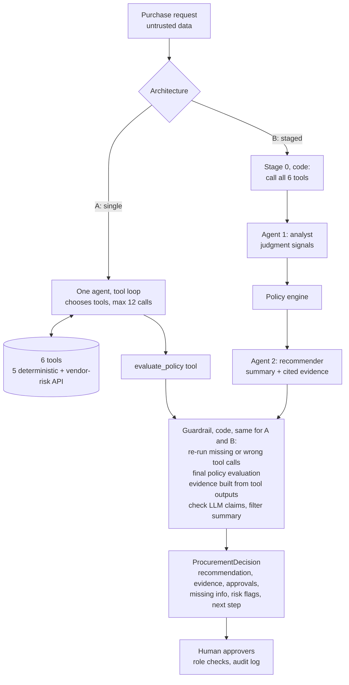

# Architecture and workflow

## Principle

| Layer | Decides | Never decides |
|---|---|---|
| Code (policy engine, tools) | Required fields, cost tier, budget, review dates, vendor status, conflicts, approvals, risk flags, next action | Wording |
| LLM | Sensitive data implied by the text, whether the purpose is clear, whether an existing tool already covers the need, the reviewer summary, questions for the requester | Approvals, thresholds, dates, statuses |
| Human | Every approval, rejection and exception | |

LLM judgment enters the policy engine only as *signals* that can add reviews ("escalate, never de-escalate"). Prompt injection can therefore change wording at most, never routing.

## Workflow

## Tools

| Tool | Kind | Source |
|---|---|---|
| `lookup_requester` | deterministic | employees.csv (manager, department head with fallback up the reporting line) |
| `check_budget` | deterministic | department_budgets.csv |
| `search_catalog` | deterministic | software_catalog.csv (same vendor, product or category) |
| `get_purchase_history` | deterministic | purchase_history.csv + other open requests (split-purchase check) |
| `get_vendor_registry` | deterministic | vendors.csv (name normalised) |
| `get_vendor_risk` | external API | mock vendor-risk service; retries, 404 = no record, 5xx/timeout/malformed = unavailable |
| `evaluate_policy` | deterministic | src/copilot/policy.py, sections 1 to 11 of the policy |

Every tool returns the same envelope (`call_id`, `ok`, `data`, `error`, `source`). Evidence items cite the call id.

## Agents

- **A, single agent:** Gemini/LM Studio function calling. The agent sees the request (in `<untrusted_data>` tags) and the policy, chooses tools, calls `evaluate_policy` with its signals, then returns structured JSON (schema-constrained).
- **B, staged:** code calls all evidence tools in a fixed order; the analyst returns signals only; the policy engine runs; the recommender writes the summary and cites call ids. Two LLM calls, always.

## Guardrail (same code path for A and B, `src/copilot/pipeline.py`)

1. Every evidence tool must have run with the request's real arguments; anything skipped or called with other arguments is re-run by code and logged as an agent defect.
2. The policy engine makes the final decision from those facts plus the LLM signals.
3. Evidence shown to the user is built by code from tool outputs, not written by the LLM.
4. LLM evidence claims are checked against the cited tool output (numbers and dates must appear); ungrounded claims are dropped and counted.
5. The summary and requester questions are rejected if they claim approval or say a review can be skipped.
6. Schema-invalid output gets one repair retry; if the LLM fails, the decision comes from the deterministic checks with an `llm_unavailable` flag.
7. `human_review_required` is always true; the UI enforces who may approve which role.

## Handoff format

`ProcurementDecision` (src/contracts.py). The UI adds per-role approve/reject with mandatory reason, requester and separation-of-duties checks, and an append-only audit log (SQLite, `runs/approvals.db`).

## Stop and escalation conditions

| Condition | Next action |
|---|---|
| Requester not in directory | Escalate to manual review |
| Vendor blocked | Do not proceed |
| Required information missing, invalid or unclear | Request clarification (no approval routing) |
| Vendor-risk service unavailable or registry/service conflict | Verify evidence first, Security added |
| Existing tool overlaps and no credible gap stated | Review the existing tool first |
| Otherwise | Route to the listed approvers |

## Intentionally not built

Purchasing, budget changes, contract acceptance, email/Slack notifications, authentication (the UI's "acting as" selector stands in for SSO), seat-usage data, multi-currency.
